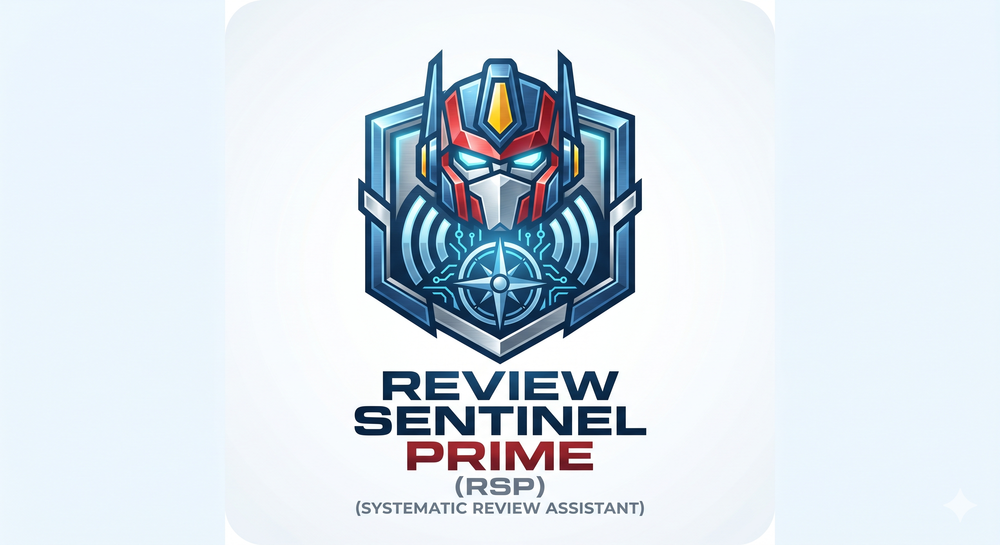

# Review Sentinel Prime (RSP)



## A locally-run, browser-based tool for Systematic Literature Reviews — no cloud account required

v2.3.0 · Python 3.12 · Flask 3.1 · Docker ready

---

## What is RSP?

**Review Sentinel Prime** is a locally run web application. It lets researchers search up to **12 scientific databases simultaneously** using Boolean query syntax (`OR`, `AND`, parentheses), filter and validate results, generate PRISMA 2020 flow diagrams, and export SLR replication packages — all from a browser interface with no coding required. Searches and optional online services require network connections; researchers must review the evidence and reporting themselves.

---

## Features

| Feature | Description |
| --- | --- |
| ▸ **Multi-database search** | Search IEEE Xplore, ACM DL, Scopus, ScienceDirect, Springer, Inspec, PubMed, arXiv, HAL, OpenAlex, EBSCO, Web of Science simultaneously (12 databases) |
| ▸ **Boolean query syntax** | Full support for `OR`, `AND`, parentheses, and exact phrases — with an in-page Query tips guide |
| ▸ **Live progress** | Real-time per-database progress panel with elapsed timer |
| ▸ **Retrieval settings** | Optionally apply the year range at each database (records outside it are counted for PRISMA, not downloaded) and set the maximum records for each database |
| ▸ **Coverage status & search log** | Each database is marked complete / partial / failed after every run (never a silent 0); a per-database `search_log.csv` (query sent, reported vs retrieved, records removed per filter, pages, retries, errors) is exported with the results |
| ▸ **Filters & criteria** | Year range, document type, language, and four color-coded filter cards (Include Terms, Exclude Terms, Include Venues, Exclude Venues) |
| ▸ **ALL / ANY match modes** | Each filter card has an inline `ALL (AND)` / `ANY (OR)` toggle — control whether all terms or any term must match |
| ▸ **Live / Offline filter mode** | Toggle between live network search and offline re-filtering against a local cache — iterate filter changes instantly without re-hitting APIs |
| ▸ **Validation papers** | Track known-relevant papers to verify search completeness |
| ▸ **Citation snowballing** | Forward / backward citation search from seed papers (DOI or title) via OpenAlex — free, no API key; new papers are merged into the results and counted in PRISMA identification |
| ▸ **Saved searches** | Save, schedule (hourly/daily/monthly), and re-run searches automatically |
| ▸ **Countdown timer** | Live countdown to the next scheduled run, anchored to `lastRun` timestamp — accurate after refreshes |
| ▸ **Email notifications** | Diff-based alerts showing new/removed papers after each scheduled run |
| ▸ **Bug reports & feature requests** | Built-in Feedback page that records submissions in the project's issue-collection forms — works even when no SMTP server is configured |
| ▸ **T&A Screening** | Manual Title & Abstract screening page — review papers one-by-one with Include / Exclude / Unsure decisions, navigate prev/next, and export decisions as CSV |
| ▸ **Full-text screening** | Review T&A-included papers per run; record inclusions, exclusions with reasons, non-retrieval and deferred decisions. The PRISMA flow and replication ZIP reflect recorded decisions and pending papers. |
| ▸ **Two-reviewer screening** | Optional per-run, per-stage reviewer decisions and adjudication. Labels are self-declared; identity and blinding are not enforced. Only resolved decisions count. |
| ▸ **AI Screening Assistant** | Optional AI suggestions during T&A screening — run privately on your own computer (Ollama, LM Studio) or use an online service (OpenAI, Anthropic, Google Gemini, Groq, OpenRouter). Guided setup with automatic model list and one-click **Test & Save**; each service's settings are remembered. The reviewer accepts or overrides each suggestion, and accepted decisions carry model provenance that feeds the PRISMA item 8 automation-tool disclosure |
| ▸ **Results Hub** | Browse and download all local run snapshots (saved and ad-hoc) from a single page |
| ▸ **Charts** | Publications per year (with trend line), abstract keyword frequency (top terms bar chart), venue, and document-type charts — all with PNG export |
| ▸ **PRISMA 2020** | Auto-generated flow diagram; clickable stage and excluded cards; Snowballing / Other Sources; Review Protocol; evidence checklist with recorded evidence and drafts that require researcher confirmation |
| ▸ **PNG export** | DOM-capture export of the PRISMA diagram and evidence checklist at 2× resolution via html2canvas |
| ▸ **Replication package** | One-click ZIP export with CSVs, JSON config, protocol, PRISMA data, README |
| ▸ **Print to PDF** | Print-ready results page (source, title, authors, year, venue, DOI), with a **Print to PDF + Abstracts** variant |
| ▸ **Import / Export config** | Save and reload the complete search configuration — including filter modes — as a JSON file |
| ▸ **Cards & List view** | Toggle between rich card and compact list result layouts |
| ▸ **Persistent UI state** | Filter and validation panel visibility is remembered across refreshes and saved-search restores |
| ▸ **API key management** | Local credential storage with per-database test connection and last-checked timestamp; optional Elsevier institutional token (Scopus/ScienceDirect/Inspec) for off-network access. Credentials are stored in plain text in `data/` |
| ▸ **Built-in manual** | Full 17-section user manual available at `/manual` |
| ▸ **Docker ready** | One-click Docker Compose deployment with start/stop scripts for Windows and macOS |

---

## Screening and PRISMA workflow

1. Open a saved or ad-hoc run from **Results** and record title-and-abstract decisions. Browser-memory-only decisions do not create full-text candidates.
2. Open **Full-text screening** for the same run. Only records included at title-and-abstract screening qualify. Record exclusions and reports not retrieved with reasons; pending and unsure papers are not final inclusions. Decisions for records that later become ineligible are retained but no longer counted.
3. Optionally enable **Two-reviewer screening** separately for either stage *before* that stage has decisions. Matching definite decisions resolve automatically; disagreements and unsure decisions require adjudication. Reviewer labels are self-declared, and neither authentication nor blinding is enforced. AI suggestions are unavailable in this mode.
4. On **PRISMA**, review the flow and consistency checks, then verify the evidence against the report. Add notes, confirm addressed checklist items and select **Save checklist**. Refresh evidence and reconfirm stale items after changes. Manual steps and other-source counts belong to the run; avoid counting full-text exclusions twice. The protocol is shared across runs.
5. Export the replication package. Depending on the run, it includes `02_data/full_text_screening.csv`, `02_data/two_reviewer_screening.json`, `02_data/prisma_manual_evidence.json` and `05_evidence_checklist/researcher_checklist.json`. Manual other-source counts are not individual full-text records. Missing or mismatched checklist evidence is marked unverified, not automatically confirmed.

Run data, screening decisions and run-specific checklist evidence are removed when the run is deleted or pruned. Older browser-only checklist notes and manual evidence can be imported explicitly after checking that they belong to the run; checklist confirmations are not imported.

---

## What's New in v2.3.0

- **Run-scoped full-text screening** — record included, excluded, not-retrieved and deferred reports, with reasons and pending counts in the PRISMA flow and replication package.
- **Optional two-reviewer screening** — record separate decisions and adjudicate disagreements in either screening stage. Reviewer labels are self-declared; identity and blinding are not enforced.
- **PRISMA evidence workflow** — guided completion and consistency checks, researcher-confirmed checklist items, stale-evidence warnings, and run-scoped checklist notes and manual evidence.
- **Retrieval and documentation** — configurable limits for all databases, refreshed settings and screening visuals, and updated guides and workflow illustrations. Provider limits and connector safeguards still apply.

---

## What's New in v2.2.4

- **No more silent zeros** — after every search, a **Database coverage** table shows each database as *Complete*, *Partial* or *Failed*, with the reason (quota, rate limit, network error, retrieval cap, rejected query). The same status appears on the PRISMA database chips, on scheduled searches ("⚠ incomplete coverage") and in notification emails. Records from a partial database are kept.
- **Per-database search log** — `search_log.csv` / `.json` in the replication package and the Results Hub ZIP: the query sent to each API, total reported, retrieved, records removed by each filter, pages, retries, errors and status.
- **More reliable retrieval** — automatic retries with backoff for rate limits (429), server errors, timeouts and network errors, honouring `Retry-After`; each API's documented page size and request rate; quota exhaustion is reported with the time until it resets. Fixes OpenAlex returning 0 after its daily budget ran out, arXiv stopping silently on empty pages, and Scopus failing on a transient network error.
- **Settings → Retrieval** — optionally apply the year range at the database (records outside it are counted for PRISMA as *Removed before retrieval*, not downloaded), and set the maximum records for each database, with request estimates and known limits shown. Provider quotas and connector safeguards can stop retrieval earlier.
- **OpenAlex API key (optional)** — a free key raises OpenAlex's daily budget 10× and supports cursor paging; the current RSP retrieval setting still caps a database at 10,000 records. The connection test shows the credits left.
- **PRISMA** — the flow diagram adds *Removed before retrieval* (date limit at the database, or not retrieved) and *Records retrieved*, so the numbers always add up.
- **Fixes** — Springer's year filter now uses the documented `datefrom`/`dateto` constraints; duplicates are attributed to databases in a fixed order; exclude-term phrases match across line breaks; terms can be entered one per line; *ALL* mode for exclude terms is respected when filters are sent to the APIs.

---

## What's New in v2.2.3

- **Print to PDF + Abstracts** — the results export bar now offers two buttons: **Print to PDF** (source, title, authors, year, venue, DOI) and **Print to PDF + Abstracts** (adds each paper's abstract; a much longer PDF). The "include abstracts?" prompt for large result sets is gone.
- **Documentation review** — the Manual now covers Citation Snowballing and the PRISMA *Snowballing / Other Sources* panel; the Results Hub, Screening (reasons, Summary tab), Charts and Settings sections, the key table (Web of Science, EBSCO, OpenAlex) and Figures 7 and 9 were corrected to match the app. README, About page and QA guide updated.

---

## What's New in v2.2.2

- **Correct result count after reload** — reopening the Search page no longer mixes an older search's results into the latest one (e.g. 16,494 shown vs 2,242 in PRISMA). The list, exports and Print to PDF now always match the PRISMA "Studies included" count.
- **Print to PDF no longer hangs** — large result sets are rendered progressively with a progress indicator and an explicit **Print / Save as PDF** button; above 1,000 results you can choose to leave out abstracts.

---

## What's New in v2.2.1

- **Large result sets fixed** — searches with more results than the browser can store (e.g. 10,000+) no longer show a reduced count on the Search page or in **Print to PDF**. The full set is reloaded from the saved run, so the result list, exports and PDF match the PRISMA "Studies included" count.
- **macOS/Linux launchers** — `start.command` / `stop.command` scripts built on Windows now keep LF line endings, fixing `env: bash\r: No such file or directory`.

---

## What's New in v2.2.0

- **AI Screening Assistant** — optional AI suggestions during T&A screening, running locally (Ollama, LM Studio) or via an online service (OpenAI, Anthropic, Gemini, Groq, OpenRouter). Guided setup, one-click **Test & Save**, per-service settings, recommended-model tags, privacy confirmation, batch estimate, and one-click Ollama model download.
- **AI provenance & agreement** — each decision records the AI suggestion, confidence and model; the Screening page and PRISMA items 8/23c report reviewer–AI agreement (Cohen's κ).
- **PRISMA automation** — checklist evidence and drafts from recorded data; the replication package includes risk-of-bias (RoB 2 / ROBINS-I) and GRADE certainty templates. Researchers confirm each checklist item against their report.
- **Docker** — the container can reach Ollama / LM Studio on the host via `host.docker.internal`.

---

## What's New in v2.1.1

- **Elsevier institutional token (optional)** — Settings now has an optional institutional token field, shared by Scopus, ScienceDirect and Inspec (Engineering Village). It's only needed if requests run from outside your institution's network and get rejected despite a valid API key; leave it blank and all three services keep working exactly as before.
- **Documentation fixes** — Manual corrected from "10" to "12" supported databases and a dead cross-reference pointing to the wrong section.

---

## What's New in v2.1.0

### ⚠️ Behaviour change

Include/exclude **term filters now also match author keywords**, in addition to title and abstract. Re-running an existing saved search may return a different set of papers than it did on v2.0.1 — re-run your searches before comparing PRISMA counts against earlier exports.

### New databases (10 → 12)

- **Web of Science** — Clarivate API key. Two editions share one key, selectable in Settings: *Starter* (free, self-service, **returns no abstracts**, as few as 50 requests/day) and *Expanded* (institutional subscription, full records with abstracts). Requests are throttled to stay inside the free-tier rate limit.
- **EBSCO Discovery Service** — institutional EDS subscription, authenticated with User ID + Password + Profile ID. EBSCO's licence restricts caching and redistribution of retrieved metadata.

### PRISMA 2020 evidence checklist — now largely automated

- Artefact rows are marked `[OK]` / `[--]` from the ZIP's actual contents, so the checklist no longer claims files that were not produced.
- Records excluded **with reasons** — all eight filter reasons, with a total.
- Title & abstract screening totals, including records not yet screened.
- **Identification by source** — databases/registers vs citation searching. Snowballed records were previously counted as database hits.
- **Validation (seed) paper recall** — reports which known papers the search actually retrieved, and flags a query that may be too narrow.
- **Automation disclosure** — AI-assisted decision count and model(s), as required when automation tools are used in study selection.
- **Items still needing manual attention** — registration, reviewer count, protocol items 11–15/25/26, and any database that errored or was truncated.
- Mapping extended to PRISMA items 5, 24a, 24b and 27.

### Data format (additive)

- `screening_decisions.csv` gains `ai_assisted`, `ai_model`, `ai_vendor`, `ai_suggested` and `ai_confidence` columns.
- `prisma_data.json` gains `identification.other_methods`.
- New fill-in templates: `02_data/risk_of_bias_template.csv` (per included study, domains match the protocol's tool) and `02_data/grade_certainty_template.csv` (per protocol outcome).

> **Security:** API keys (AI and database) are stored as plain text in `data/` (e.g. `data/ai_config.json`). Do not share, sync or commit the `data/` folder.

### Interface

- Search and Saved Searches: database checkboxes grouped into *Ready to use — no API key* and *Requires an API key*.
- Settings: database cards grouped by required credentials, optional keys and no-key connections, with the three Elsevier services (Scopus, ScienceDirect, Inspec) placed together since they share one key.

### Documentation

Manual, About page and release guides updated to 12 databases; manual Figure 2 redrawn to match the grouped database selector.

---

## What's New in v2.0.1 — Initial Release

This is the first public release of Review Sentinel Prime. Highlights include:

- **Multi-database search** across 12 scientific databases with Boolean query syntax, live progress tracking, and configurable filters/criteria
- **T&A Screening** with an optional AI Screening Assistant (local via Ollama / LM Studio, or online via OpenAI, Anthropic, Gemini, Groq, OpenRouter) that suggests Include/Exclude/Unsure decisions for the reviewer to accept or override
- **PRISMA 2020 support** — auto-generated flow diagram, Review Protocol form, and an Evidence Checklist that presents recorded evidence for researcher review and confirmation
- **Saved searches** with scheduled re-runs and diff-based email notifications
- **Feedback, feature request, and survey collection** relayed server-side to Google Forms, working even without SMTP configured
- **Replication package export** — one-click ZIP with CSVs, JSON config, protocol, and PRISMA data
- **Results Hub and charts** for browsing local run snapshots and visualizing publications, keywords, venues, and document types
- **Security hardening** — atomic JSON writes with locking, restart-safe schedules, whole-word filter matching, and XSS/CSV-injection protection
- Released under the GNU General Public License v3.0

---

## Supported Databases

| Database | API Key Required |
| --- | --- |
| IEEE Xplore | Yes — free at `developer.ieee.org` |
| ACM Digital Library | No key — but ACM has no public API and blocks automated server-side access; RSP reports this explicitly during a search |
| Scopus | Yes — free at `dev.elsevier.com`. Optional institutional token also needed if searching from outside your institution's network |
| ScienceDirect | Yes — same Elsevier key as Scopus, and the same optional institutional token |
| Springer Nature | Yes — free at `dev.springernature.com` |
| Inspec (Engineering Village) | Yes — same Elsevier key as Scopus (same optional institutional token applies) |
| PubMed | Optional (improves rate limits) |
| arXiv | No |
| HAL Open Science | No |
| OpenAlex | Optional — works without a key, but the keyless budget is about 100 searches/day (one large search can use it up); a free key from `openalex.org` raises it 10× |
| EBSCO Discovery Service | Yes — institutional EDS subscription (User ID, Password *and* Profile ID); EBSCO's licence restricts caching and redistribution of retrieved metadata |
| Web of Science | Yes — two editions share one key. **Starter**: free at `developer.clarivate.com`, but returns **no abstracts** and free plans allow as few as 50 requests/day. **Expanded**: paid institutional subscription, full records with abstracts |

---

## Getting Started

### Option A — Docker (recommended, no Python required)

> Requires [Docker Desktop](https://www.docker.com/products/docker-desktop) (free).

1. Download and extract the release ZIP.
2. **Windows:** double-click `start-app.bat`
3. **macOS:** double-click `start-app.command`
4. Open your browser at **[http://localhost:8090](http://localhost:8090)**

See [`releases/docker/README.md`](releases/docker/README.md) for the full step-by-step guide.

### Option B — Python (development / direct run)

> Requires Python 3.12+.

```bash
# Clone the repository
git clone <repo-url>
cd ReviewSentinelPrime

# Create and activate a virtual environment
python -m venv .venv
source .venv/bin/activate        # macOS/Linux
# .venv\Scripts\activate         # Windows

# Install dependencies
pip install -r requirements.txt

# Run the app
python app.py
```

Open **[http://localhost:5001](http://localhost:5001)** in your browser.

On macOS/Linux you can also double-click `releases/python/start.command`.  
On Windows, double-click `releases/python/START.bat`.
To stop launcher-based runs, use `releases/python/stop.command` (macOS/Linux) or `releases/python/STOP.bat` (Windows).

macOS note for release ZIP users: if Gatekeeper blocks a launcher on first run,
open Terminal in the extracted folder and run:

```bash
find . -name "*.command" -exec chmod 755 {} \;
xattr -dr com.apple.quarantine .
```

Then right-click the launcher and choose Open once.

---

## Project Structure

```text
ReviewSentinelPrime/
├── app.py                  # Flask application & all API routes
├── requirements.txt        # Python dependencies
├── run.sh / run.bat        # Run from a repository checkout (activates .venv or venv)
├── build-releases.sh/.ps1  # Stamp the version and build the release ZIPs
├── index.html              # Quick-start launcher page (docs/index.html is the copy for docs/)
├── templates/              # Jinja2 HTML templates (pages and the built-in manual)
├── static/                 # CSS, JavaScript, images
├── data/                   # Saved searches, API keys, results (created at runtime)
│   └── results/            # Per-search result history (JSON)
├── qa/                     # Automated pytest suite (see qa/docs/README.md)
├── scripts/dev/            # Developer helpers (e.g. email preview, key diagnostics)
└── releases/
    ├── docker/             # Docker Compose files + user guide README
    ├── python/             # One-click Python launcher scripts + user guide README
    └── relay/              # Feedback / survey relay configuration
```

---

## Filter System

The four filter fields are displayed as color-coded cards on both the **Search** page and the **Saved Searches** page:

| Card | Color | Behaviour |
| --- | --- | --- |
| **Include Terms** | 🟢 Green | Only papers whose title, abstract or author keywords contain these terms are kept (case-insensitive, whole-word/phrase matching; quoted terms supported) |
| **Exclude Terms** | 🔴 Red | Papers whose title, abstract or author keywords contain these terms are removed (same whole-word matching) |
| **Include Venues** | 🟢 Green | Only papers whose journal/conference name matches are kept (partial match against the venue name only, never the source database; leave empty for all) |
| **Exclude Venues** | 🔴 Red | Papers whose journal/conference name matches are removed — to exclude an entire database, uncheck it instead |

Enter terms and venues separated by commas or one per line; keep a phrase that contains a comma in double quotes. The year range is applied by RSP after download by default (so PRISMA lists every removed paper); **Settings → Retrieval** can apply it at the database instead, counting the records outside it for PRISMA without downloading them.

Each card has an inline **`ALL (AND)`** / **`ANY (OR)`** match mode dropdown:

- **ALL (AND)** — the paper must contain *every* listed term/venue (default for Include Terms)
- **ANY (OR)** — the paper must contain *at least one* of the listed terms/venues (default for Exclude Terms and both venue cards)

> **Tip:** Keep Include Venues on **ANY (OR)** when listing multiple distinct journals (e.g. `TSE, ICSE`) — no paper can belong to all venues simultaneously.

---

## Tech Stack

- **Backend:** Python 3.12, Flask 3.1, APScheduler 3.10, requests 2.32
- **Frontend:** Vanilla JS, Chart.js 4.4, html2canvas 1.4.1, Jinja2, Inter (Google Fonts)
- **Deployment:** Docker & Compose, or direct Python
- **Storage:** Local JSON files — no database server required

---

## Origins & Credits

Review Sentinel Prime (RSP) builds upon the [Replication Package Builder](https://github.com/zemacedo99/Replication-Package-Builder), a tool designed to compile scientific publications from multiple academic databases (IEEE Xplore, ACM Digital Library, Scopus, ScienceDirect, HAL Open Science, Springer Nature, Inspec, PubMed, arXiv, and more) to support Systematic Literature Reviews and Mappings. The original tool was used to produce a published replication package for a systematic literature mapping in the aerospace domain. RSP (2026) extends this vision with a lightweight, locally-run web interface that lets researchers — regardless of coding experience — search databases, schedule automated runs, and manage results entirely in the browser.

RSP brings together work from three distinct sources. Each is credited and cited separately below to avoid confusion.

### 1. This application — Review Sentinel Prime (RSP)

- **Author:** J. Eduardo Ferreira Ribeiro
- **Contributor:** Nuno Pessoa Soares

If RSP helped produce a paper, thesis, or report, please cite it as:

```bibtex
@software{ribeiro2026rsp,
  author  = {Ferreira Ribeiro, J. Eduardo and Pessoa Soares, Nuno},
  title   = {Review Sentinel Prime (RSP)},
  year    = {2026},
  url     = {https://github.com/ribeiroe/ReviewSentinelPrime}
}
```

### 2. Original tool RSP is built upon — Replication Package Builder

- **Authors:** J. Eduardo Ferreira Ribeiro, J. Antonio Dantas Macedo

> "We want to thank J. Eduardo Ferreira Ribeiro and J. Antonio Dantas Macedo for their substantial contributions in developing and providing the Replication Package Builder, upon which Review Sentinel Prime (RSP) is based."

Please reference the original repository:

```bibtex
@misc{ribeiro2024replicationpackagebuilder,
  author = {Ferreira Ribeiro, J. Eduardo and Dantas Macedo, J. Antonio},
  title  = {Replication Package Builder},
  year   = {2024},
  url    = {https://github.com/zemacedo99/Replication-Package-Builder}
}
```

### 3. Example dataset produced using the original tool

This is a published research dataset created *using* the Replication Package Builder — its authors are the researchers of that study, not the authors of the tool itself.

- **Authors:** J. Eduardo Ferreira Ribeiro, J. Gabriel Silva, A. Aguiar
- **DOI:** [10.5281/zenodo.13763171](https://doi.org/10.5281/zenodo.13763171)

```bibtex
@dataset{ribeiro2024replicationpackage,
  author    = {Ferreira Ribeiro, J. Eduardo and Gabriel Silva, J. and Aguiar, A.},
  title     = {Replication Package for a Systematic Literature Mapping of Agility in
               Safety-Critical Software Development within the Aerospace Industry},
  year      = {2024},
  publisher = {Zenodo},
  doi       = {10.5281/zenodo.13763171}
}
```

**Full citation (APA) for the dataset above:**
> Ferreira Ribeiro, J. E., Gabriel Silva, J., & Aguiar, A. (2024). *Replication Package for a Systematic Literature Mapping of Agility in Safety-Critical Software Development within the Aerospace Industry* [Data set]. Zenodo. [https://doi.org/10.5281/zenodo.13763171](https://doi.org/10.5281/zenodo.13763171)

---

## Community Support (Optional)

RSP is free and will remain free under the GNU General Public License v3.0. If it helps your work, you can optionally support RibeiroLabs to help cover development, maintenance, and hosting costs. Tipping unlocks no features, no early access, no priority, and comes with no support commitment — tips are voluntary.

- Ko-fi: [https://ko-fi.com/ribeirolabs](https://ko-fi.com/ribeirolabs)
- In-app locations: global footer, About page, and the Charts, PRISMA, Results, and Screening pages

---

## Note on AI Use

RSP's only stage that uses a language model is the optional **AI Screening Assistant** (Settings → AI Screening Assistant), which suggests Include / Exclude / Unsure decisions during Title & Abstract screening. It is disabled by default. No other stage (search, filtering, PRISMA generation, export) uses a language model.

### Setting up the AI Screening Assistant

1. Open **Settings → AI Screening Assistant** and set *Assistant* to **Enabled**.
2. Under **Where should the AI run?** choose one option — the page shows step-by-step instructions for it:
   - **Ollama** or **LM Studio** — runs on a computer you control; titles and abstracts are sent to the configured model server. Install the app, download a model, and (LM Studio) start its server. To use one running on another computer on your network, replace `localhost` with that computer's IP address (Ollama: set `OLLAMA_HOST=0.0.0.0` on that computer; LM Studio: enable *Serve on Local Network*).
   - **OpenAI, Anthropic, Google Gemini, Groq, OpenRouter** — online services; paste your API key (the page links to where to get one). Titles and abstracts are sent to that provider and usage is billed to your account.
   - **Other / custom server** — any OpenAI-compatible or Ollama-compatible server.
3. Choose a model from the list (it fills in automatically once connected; *Other* lets you type a name).
4. Click **Test & Save** — settings are saved only if the model answers correctly; otherwise a plain-language message explains what to fix.

With Ollama selected, a **Download** button installs a recommended model (Qwen 2.5 7B, Gemma 3 12B or Gemma 3 27B) without using a terminal. In the model list, ★ marks recommended models and ⚠ marks ones to avoid (reasoning or very small models).

During screening, online services require a one-time privacy confirmation, batch runs show an estimated time and cost first, and unreadable AI replies are retried once automatically. Every suggestion is recorded with vendor, model, suggested decision and confidence (even when overridden), and the Screening page and PRISMA items 8/23c report reviewer–AI agreement (% and Cohen's κ).

Each option remembers its own address, model, and API key, so switching back and forth needs only a selection and **Test & Save**. Settings are stored in `data/ai_config.json` (API keys in plain text, like the other keys in `data/`; the folder is git-ignored — don't share it).

> **Ollama on another computer:** see the in-app Manual → *Settings & API Keys → Using Ollama on another computer* for step-by-step setup (network access, firewall, IP address). Only do this on a trusted network — Ollama has no password and traffic is not encrypted.

> **Docker users:** inside the container, `localhost` is the container itself. To reach Ollama / LM Studio on the same computer, use `http://host.docker.internal:11434` (Ollama) or `http://host.docker.internal:1234/v1` (LM Studio) as the server address.

Language model output is probabilistic and can be wrong. Every suggestion is a starting point only: the reviewer must accept, override, or reject each one, and all AI-assisted decisions must be verified by the reviewer before being used in any publication or report. RSP is a research support tool — it is not intended for clinical, legal, employment, or other regulated decision-making. RSP is provided as-is under the GNU General Public License v3.0, without warranty of any kind (see [LICENSE](LICENSE), Sections 15 and 16).

---

## License

**Review Sentinel Prime (RSP) itself is released under the [GNU General Public License v3.0](LICENSE).**

The upstream Replication Package Builder it builds upon is released under the [MIT License](https://github.com/zemacedo99/Replication-Package-Builder/blob/main/LICENSE).  
The associated Zenodo dataset is licensed under [CC BY 4.0](https://creativecommons.org/licenses/by/4.0/).
