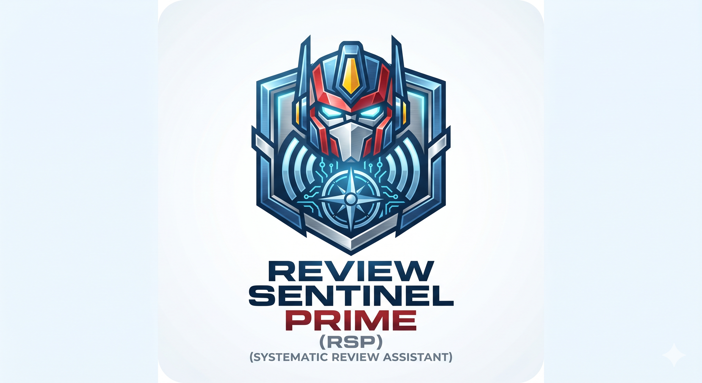

# Review Sentinel Prime v2.0.1 — Python Edition



> **You do not need to be a developer to use this app.**  
> If you can double-click a file, you can run it.  
> Follow this guide step by step and you will be up and running in minutes.

---

## Table of Contents

1. [What is Review Sentinel Prime?](#1-what-is-review-sentinel-prime)
2. [What you need before starting](#2-what-you-need-before-starting)
3. [Step 1 — Install Python](#3-step-1--install-python)
4. [Step 2 — Extract the ZIP file](#4-step-2--extract-the-zip-file)
5. [Step 3 — Start the app](#5-step-3--start-the-app)
6. [Step 4 — Open the app in your browser](#6-step-4--open-the-app-in-your-browser)
7. [How to stop the app](#7-how-to-stop-the-app)
8. [How to start it again later](#8-how-to-start-it-again-later)
9. [Troubleshooting](#9-troubleshooting)

---

## 1. What is Review Sentinel Prime?

**Review Sentinel Prime (RSP)** is a tool for researchers who need to search scientific databases as part of a **Systematic Literature Review (SLR)**.

Instead of visiting Google Scholar, IEEE, PubMed, arXiv, and others one by one, this app lets you search up to **ten databases at the same time** from a single screen — and automatically removes duplicate results.

**Everything runs on your own computer.** Your search history, API keys, and results never leave your machine.

---

## 2. What you need before starting

| Requirement | Details |
| --- | --- |
| **Python 3.12 or later** | Free — download from [python.org](https://www.python.org/downloads/) |
| **Internet connection** | Required for searching databases and downloading dependencies (first run only) |
| **A modern browser** | Chrome, Firefox, Edge, or Safari all work |

That is all. You do not need to install anything else.

> **Already have Python?** Open a terminal or command prompt and type `python --version` (Windows) or `python3 --version` (macOS/Linux). If you see a version number of 3.12 or higher, you are ready.

---

## 3. Step 1 — Install Python

Skip this section if Python 3.12+ is already installed on your computer.

### Windows (install Python)

1. Go to **[https://www.python.org/downloads/](https://www.python.org/downloads/)**
2. Click the big yellow **"Download Python"** button.
3. Open the downloaded installer.
4. **Important:** At the bottom of the first screen, tick the box that says **"Add Python to PATH"** before clicking Install.
5. Click **Install Now** and wait for it to finish.
6. Click **Close**.

### macOS (install Python)

1. Go to **[https://www.python.org/downloads/](https://www.python.org/downloads/)**
2. Click the big yellow **"Download Python"** button.
3. Open the downloaded `.pkg` file and follow the on-screen instructions.
4. Click through all the steps, accepting the default options.

### Linux (Ubuntu / Debian)

Python 3 is usually already installed. If not, open a terminal and run:

```bash
sudo apt update && sudo apt install -y python3 python3-venv python3-pip
```

---

## 4. Step 2 — Extract the ZIP file

1. Find the ZIP file you downloaded (e.g. `ReviewSentinelPrime_v2.0.1_python.zip`).
2. **Right-click** the ZIP file and choose:
   - Windows: **Extract All…** → choose a location (e.g. your Desktop or Documents folder) → click **Extract**
   - macOS: **double-click** the ZIP file — it extracts automatically
   - Linux: right-click → **Extract Here**, or run `unzip ReviewSentinelPrime_v2.0.1_python.zip`
3. You should now have a folder called `ReviewSentinelPrime` (or similar). Open it.

> **Do not run the app from inside the ZIP file.** Always extract it first.

---

## 5. Step 3 — Start the app

Inside the extracted folder, you will find a launcher file for your operating system.

### Windows (start app)

1. Open the `ReviewSentinelPrime` folder.
2. **Double-click `START.bat`**.
3. A black terminal window will open showing progress messages.
4. **The very first time**, the app installs its dependencies — this takes **1–3 minutes** depending on your internet speed. Please wait and do not close the window.
5. When you see the message `Running on http://127.0.0.1:5001`, the app is ready.
6. Your browser will open automatically.

> If Windows asks "Do you want to allow this app to make changes?", click **Yes**.

### macOS (start app)

1. Open the `ReviewSentinelPrime` folder.
2. **Double-click `start.command`** — a Terminal window opens and the app starts.
If macOS shows a security warning or says it cannot verify the file, open Terminal in the extracted folder and run:

```bash
find . -name "*.command" -exec chmod 755 {} \;
xattr -dr com.apple.quarantine .
```

Then right-click `start.command` → choose **Open** → click **Open** in the dialog.
You only need to do this once per extracted copy.
3. **The very first time**, the app installs its dependencies — wait until you see `Running on http://127.0.0.1:5001`.
4. Your browser will open automatically.

### Linux

1. Open a terminal in the `ReviewSentinelPrime` folder.
2. Make the script executable (once only): `chmod +x start.command`
3. Run it: `./start.command`
4. Wait for `Running on http://127.0.0.1:5001`, then open your browser.

---

## 6. Step 4 — Open the app in your browser

Once the app has started, your browser should open automatically to:

**[http://127.0.0.1:5001](http://127.0.0.1:5001)**

If your browser does not open automatically, open it yourself (Chrome, Firefox, Edge, or Safari all work) and type this address in the address bar:

```text
http://127.0.0.1:5001
```

> **Tip:** Bookmark this address so you can open the app instantly next time.

---

## 7. How to stop the app

When you are done working:

- **Windows:** double-click `STOP.bat` in the same folder as `START.bat`
- **Windows (reset mode):** run `STOP.bat /reset` to force-release port 5001 if needed
- **macOS:** double-click `stop.command` in the same folder as `start.command`
- **Linux:** run `./stop.command` in the app folder (use `./stop.command --reset` to force-release port 5001)

The app will stop and it is safe to close the terminal.

> **Your data is safe.** All your saved searches, API keys, and results are stored in the `data/` folder inside the app folder. They are never deleted when you stop the app.

---

## 8. How to start it again later

Starting the app a second time is much faster — **usually under 10 seconds** — because the first-time setup is already done.

Just **double-click `START.bat`** (Windows) or **double-click `start.command`** (macOS) again.

---

## 9. Troubleshooting

### "Python was not found" or "python is not recognized"

Python is not installed or was not added to PATH during installation.

→ Re-install Python from [python.org](https://www.python.org/downloads/) and make sure to tick **"Add Python to PATH"** on Windows.

---

### The terminal window closes immediately

Something went wrong during startup.

→ On Windows: right-click `START.bat` → **Run as administrator** and try again.  
→ Check that your Python installation is complete by opening a command prompt and typing `python --version`.

---

### "Dependency installation failed" or pip errors

Your internet connection may have dropped during the first-run setup.

→ Make sure you are connected to the internet and double-click the launcher again — it will resume automatically.

---

### The browser does not open automatically

→ Open your browser manually and go to **[http://127.0.0.1:5001](http://127.0.0.1:5001)**.

---

### "Address already in use" or "Port 5001 is in use"

Another program (possibly a previous instance of RSP) is already using the port.

→ On **Windows:** open Task Manager → find Python → End Task, then start the app again.  
→ On **macOS/Linux:** run `kill -9 $(lsof -ti :5001)` in a terminal, then start again.

---

### The app opens but looks broken (no styling or images)

→ Press **Ctrl+Shift+R** (Windows/Linux) or **Cmd+Shift+R** (macOS) to do a hard refresh.

---

### "Test Connection" shows an error for my API key

Settings tests all API connections through the app's backend. If a key is rejected:

→ Check the error message — it includes the exact reason and a link to the provider's portal.  
→ Common causes: key not yet approved (IEEE takes 1–2 business days), key expired, or wrong key pasted.  
→ **HAL, arXiv, and OpenAlex do not require keys** — they should always connect successfully. ACM Digital Library also needs no key, but ACM blocks automated server-side access, so its search may report an explicit error instead of results.

---

### I need help

Please contact the research team and include:

- A screenshot of the terminal window showing the error.
- Your operating system (Windows 10/11, macOS version, Linux distribution) and Python version (`python --version`).

---

Review Sentinel Prime v2.0.1 — Systematic Literature Review Automation Platform
